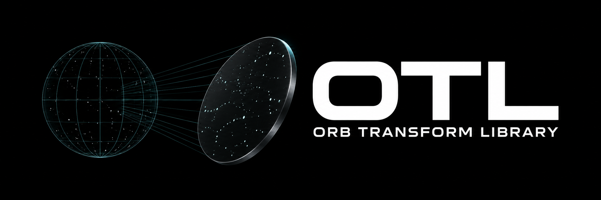
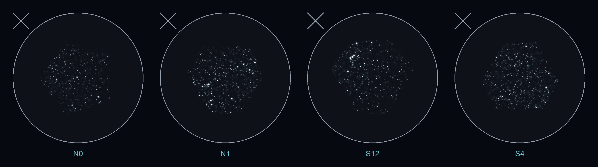
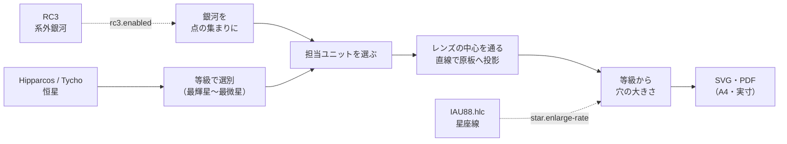
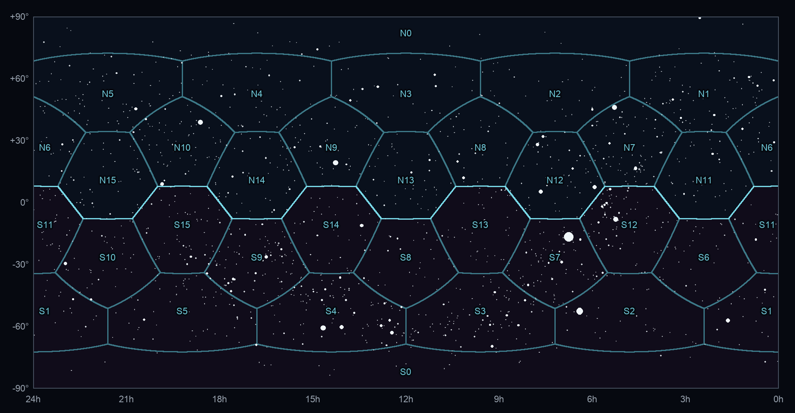

<p align="center">
  
</p>

<p align="center">
  <strong>天球の星を、プラネタリウムの恒星原板へ。</strong><br>
  Transform the celestial sphere into star plates for planetarium projectors.
</p>

<p align="center">
  <a href="requirements.txt"></a>
  <a href="LICENSE"></a>
  <a href="NOTICE"></a>
  
</p>

<p align="center">
  <a href="#クイックスタート">クイックスタート</a> ·
  <a href="#仕組み">仕組み</a> ·
  <a href="#使い方">使い方</a> ·
  <a href="#ドキュメント">ドキュメント</a> ·
  <a href="#ライセンス">ライセンス</a>
</p>

---

**OTL（Orb Transform Library）** は、レンズ式プラネタリウム投影機の恒星原板（星の穴をあける版下）を生成する Python ツールです。
Hipparcos / Tycho 星表の星（同梱の設定では銀河の点と合わせて約 2 万 8 千個）を、ドーム・投影機・レンズの寸法に合わせて各原板上の位置と穴の大きさへ変換し、SVG と印刷用 PDF に書き出します。



<p align="center"><sub>同梱の設定（正十二面体の面と頂点の 32 ユニット）で生成した原板のうち 4 枚。左から N0（北天極）・N1（カシオペヤ座）・S12（オリオン座）・S4（みなみじゅうじ座）。星が六角形・五角形の範囲に収まっているのは、各原板が担当する星域だけを描くためです。プレビューは見やすいように黒地に白で描き、星の穴を 3 倍に拡大しています。</sub></p>

## 特徴

- **実際の光学系どおりの位置**: ドーム半径・投影機の位置・原板の位置・レンズの焦点距離から、星の光がレンズの中心を通ってドームに届く位置を逆算して穴をあけます。
- **正十二面体のユニット配置**: 正十二面体の面・頂点・辺の方向から投影ユニットの向きを選べます。各星は、原板の中心に最も近く写るユニットが担当します。
- **明るさは穴の面積で**: 等級から光量を計算し、穴の面積が光量に比例するように半径を決めます。
- **暗い星と銀河も光量どおりに**: 最微星より暗い星を確率的に残したり、RC3 カタログの銀河を光の広がりに沿った点の集まりで描いたりできます。
- **星座を見つけやすく**: 星座線を構成する星だけを、暗い星ほど大きく拡大できます。対象の星座も選べます。
- **製版に合わせた出力**: 白地に黒い星（リスフィルム）と黒地に白い星（エッチング）を切り替えられます。各原板の担当星域も別ファイルに出力できます。

## クイックスタート

Python 3 と [Git LFS](https://git-lfs.com/) を用意し、リポジトリ直下で実行します。

```bash
# 1. 星表（tyc_main.dat は約 370 MB）と依存ライブラリを用意する
git lfs install
git lfs pull
python3 -m pip install -r requirements.txt

# 2. 恒星原板を生成する（SVG）
python3 -m otl
```

同梱の設定ファイル [`config/starconfig.properties`](config/starconfig.properties) が読み込まれ、`output/inverse/star_SVG/` に `star-0.svg` 〜 `star-15.svg` が出力されます。1 ページに北天 1 枚（上）と南天 1 枚（下）の原板が入ります。

> [!NOTE]
> 星の変換が終わると `星座を処理しますか。(y/N)` と聞かれます。Enter で星だけを出力します。`y` を入力すると、確認用に星座名と星座線も原板に描きます。

> [!IMPORTANT]
> PDF は **倍率 100%・「用紙に合わせる」なし** で印刷してください。原板の寸法が変わると、ドームに正しく投影できません。原板の左上の枠外にある × 印が向きの目印です。

## 仕組み



投影機は北天用と南天用の 2 つの球に分かれ、それぞれにレンズ付きのユニットが並びます。全天を各ユニットに分担させると、次のような区割りになります（同梱の設定の場合）。



<p align="center"><sub>横軸は赤経（左が 24h）、縦軸は赤緯。青い線が原板の担当範囲の境目、明るい線が北天用と南天用の境目です。投影機の球がドームの中心から上下にずれているため、境目は赤道ちょうどではなくジグザグになります。背景は 5 等より明るい恒星です。</sub></p>

光学系の計算、ユニット配置、穴の大きさ、暗い星と銀河の描き方は [仕組み](docs/mechanism.md) で詳しく説明しています。

## 使い方

コマンドはすべてリポジトリ直下で実行します。

| コマンド | 内容 |
|---|---|
| `python3 -m otl` | 同梱の設定ファイルで恒星原板を SVG 出力 |
| `python3 -m otl -PDF` | PDF で出力 |
| `python3 -m otl --polygons` | 各原板の担当星域も出力（`-PDF` と併用可） |
| `python3 -m otl -f my.properties` | 別の設定ファイルを使う |
| `python3 -m otl -i` | 設定ファイルを使わず、質問に答えて設定する |
| `python3 -m otl -h` | ヘルプを表示 |

対話形式（`-i`）では、出力形式を `star_SVG`・`star_pdf`・`polygon_SVG`・`polygon_pdf` から複数選べます。未入力なら `star_SVG` だけを出力します。

### よく変える設定

寸法の単位は mm です。すべての設定と省略時の値は [設定の一覧](docs/configuration.md) を参照してください。

| 設定 | 内容 | 同梱の値 |
|---|---|---|
| `dome-radius` | ドームの半径 | `6500` |
| `projector-distance` | ドームの中心から投影機の中心までの距離 | `355` |
| `plate-distance` | 投影機の中心から原板の中心までの距離 | `400` |
| `focal-length` | レンズの焦点距離 | `50` |
| `unit-12` / `unit-20` / `unit-30` / `unit-60` | 正十二面体の面 / 頂点 / 辺 / 60 方向にユニットを置くか | `yes` / `yes` / `no` / `no` |
| `star-radius` | 0 等星の穴の半径 | `0.275` |
| `star.maximum` / `star.minimum` | 描く最も明るい / 暗い星の等級 | `1.5` / `7.5` |
| `star.enlarge-rate` | 星座線を構成する星の拡大率（`0`〜`2`） | `1.0` |
| `star.enlarge-constellations` | 拡大する星座（空欄で全星座） | オリオン座など 15 星座 |
| `rc3.enabled` | RC3 の銀河を描くか | `yes` |
| `plate.frame-radius` | 円形原板の枠の半径（`0` で自動） | `38.15` |
| `color.invert` | `yes`: 黒地に白い星（エッチング）、`no`: 白地に黒い星（リスフィルム） | `no` |
| `output.directory` | 出力先フォルダ | `output/inverse` |

### 出力

| サブフォルダ | 内容 |
|---|---|
| `star_SVG/` / `star_pdf/` | 恒星原板 |
| `polygon_SVG/` / `polygon_pdf/` | 担当星域（黒地に白い領域） |
| `unit_position/` | ユニットの向きを示す配置図（`unit-position-file` を指定したとき） |

用紙は A4（210 × 297 mm）です。`output.directory` を省略すると `output/default/` に出力します。

テストは次のコマンドで実行します。

```bash
python3 -m unittest discover tests
```

## ドキュメント

- [全体の構成](docs/overview.md) — 処理の流れ、フォルダとモジュール、用語、用紙への配置
- [仕組み](docs/mechanism.md) — 光学系の計算、ユニット配置、担当の決め方、穴の大きさ、暗い星・銀河・星座線
- [設定の一覧](docs/configuration.md) — すべての設定、省略時の値、ユニットの個別指定

## 関連プロジェクト

- [GingaForge](https://github.com/asanumakottii-collab/GingaForge) — Gaia DR3 から天の川原盤をつくるツール。以前 OTL にあった天の川原板の生成は GingaForge に移りました。

## ライセンス

| 対象 | ライセンス |
|---|---|
| コード（`otl/`・`tests/`・`config/`） | [GPL-2.0-or-later](LICENSE) |
| Hipparcos / Tycho 星表（`hip_main.dat`・`tyc_main.dat`） | [CC BY-NC 3.0 IGO](https://www.cosmos.esa.int/web/hipparcos/catalogues)（クレジット: ESA）。**非営利利用に限る** |
| その他の同梱データ（`rc3.dat`・`IAU88.hlc`） | 各提供元の条件（[NOTICE](NOTICE)） |
| 生成した原板（`output/`）とプレビュー画像（`plates.png`・`sky-assignment.png`） | 使用したカタログの条件に従う |

本ツールは、東京大学地文研究会天文部の Java 版 OTL（Ver. 1.4）をもとにした Python 版（Ver. 1.5）です。機能の追加や改良を行っているため、Java 版と完全に同じ結果になるとは限りません。条件の詳細は [NOTICE](NOTICE) を参照してください。

Copyright (C) 2007, 2012–2014, 2018, 2026 東京大学地文研究会天文部
