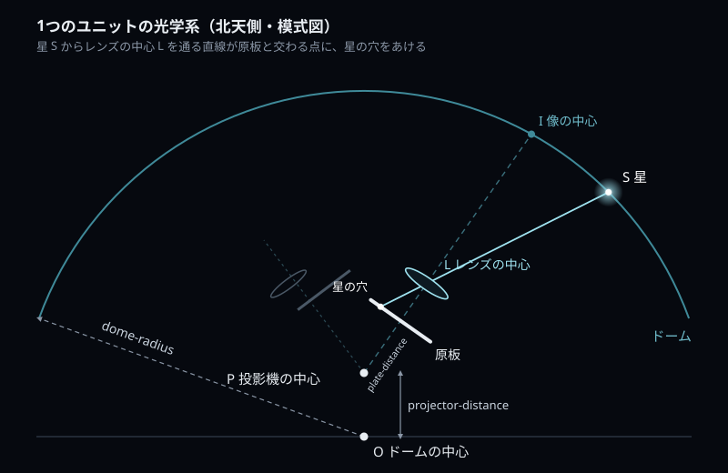
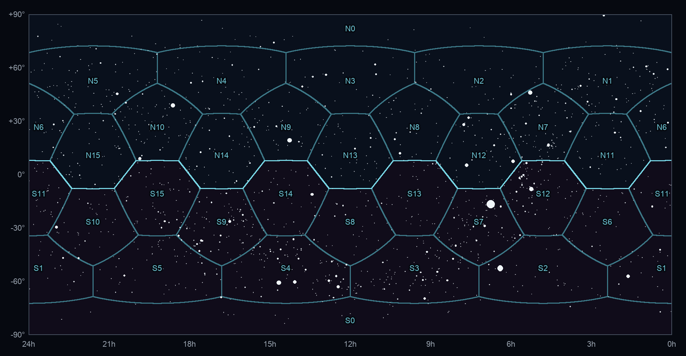

# 仕組み

OTL が天球上の星を原板の穴に変えるまでの計算をまとめます。処理の流れとモジュールは [全体の構成](overview.md)、
設定の書き方は [設定の一覧](configuration.md) を参照してください。

- [1. 投影機のモデル](#1-投影機のモデル)
- [2. ユニットの配置](#2-ユニットの配置)
- [3. 星から原板への投影](#3-星から原板への投影)
- [4. 担当ユニットの選び方](#4-担当ユニットの選び方)
- [5. 穴の大きさ](#5-穴の大きさ)
- [6. 星表の読み込みと選別](#6-星表の読み込みと選別)
- [7. 最微星より暗い星](#7-最微星より暗い星)
- [8. RC3 の系外銀河](#8-rc3-の系外銀河)
- [9. 星座線を構成する星の拡大](#9-星座線を構成する星の拡大)
- [10. 星座名と星座線](#10-星座名と星座線)
- [11. 担当星域ポリゴン](#11-担当星域ポリゴン)

## 1. 投影機のモデル

座標はドームの中心 O を原点とし、z 軸を天の北極、x 軸を赤経 0h の方向にとった赤道座標です。ドームは半径 `dome-radius` の球で、星はドームの球面上にあるものとして扱います。

投影機は北天用と南天用の 2 つの球に分かれています。

| | 中心の位置 | 担当 |
|---|---|---|
| 北天用（N） | O から天の北極の方向へ `projector-distance` | 北天のユニット |
| 南天用（S） | O から天の南極の方向へ `projector-distance` | 南天のユニット |

それぞれの球の表面に、レンズと原板を組にした **ユニット** が外向きに並びます。1 つのユニットの光軸上には、投影機の中心 P から近い順に次のものがあります。

1. 原板の中心（P から `plate-distance`）
2. レンズの中心 L（原板から距離 *a*）
3. ドーム上の像の中心 I

レンズは中心を通る光が曲がらないピンホールとして扱い、星 S と L を結ぶ直線が原板と交わる点に穴をあけます。

### レンズの位置

原板からレンズまでの距離 *a* は、原板の像がドーム上でちょうどピントが合うように決めます。

1. 三角形 OPI に余弦定理を使い、P から像の中心 I までの距離 PI を求めます（OI = `dome-radius`、OP = `projector-distance`、∠OPI はユニットの向きから決まる）。
2. 原板から像までの距離を *d* = PI − `plate-distance` とします。
3. レンズの公式 1/*f* = 1/*a* + 1/(*d* − *a*) を *a* について解き、小さいほうの解を使います（*f* = `focal-length`）。

ドームが十分に大きいと *a* は焦点距離よりわずかに長くなります。同梱の設定（ドーム半径 6500 mm、焦点距離 50 mm）では *a* ≈ 50.44 mm です。ユニットの向きによって PI が変わるので、*a* はユニットごとに少しずつ違います。

## 2. ユニットの配置

ユニットの向きは、天の北極に面を 1 つ向けた正十二面体を基準に選びます（`StandardUnitArrangement`）。

| 設定 | 向き | 北天の内訳 |
|---|---|---|
| `unit-12` | 面の中心（12 方向） | 天の北極 1 + 赤緯 26.6° に 5 |
| `unit-20` | 頂点（20 方向） | 赤緯 52.6° に 5 + 赤緯 10.8° に 5 |
| `unit-30` | 辺の中点（30 方向） | — |
| `unit-60` | 正十二面体の対称性をもつ 60 方向（全天を覆える最小の画角になるよう探索） | — |

選んだ方向を赤緯の高い順に並べ、前半を北天、後半を南天に割り当てます。番号は北天・南天とも極に近いユニットから順に振ります。

同梱の設定（`unit-12` と `unit-20`）では 32 ユニット、北天・南天 16 枚ずつです。

| 原板 | ユニットの向き（赤緯） |
|---|---|
| N0 / S0 | ±90°（天の北極 / 南極） |
| N1〜N5 / S1〜S5 | ±52.6° |
| N6〜N10 / S6〜S10 | ±26.6° |
| N11〜N15 / S11〜S15 | ±10.8° |

### 組み合わせと画角

組み合わせごとの、全天を覆うのに必要なユニットの画角（直径）の目安です。ユニットを増やすほど画角は狭くて済みます。

| 組み合わせ | 1 半球のユニット数 | 画角（直径） |
|---|---:|---:|
| `unit-12` | 6 | 約 75° |
| `unit-30` | 15 | 約 63° |
| `unit-12` + `unit-20`（同梱） | 16 | 約 45° |
| `unit-12` + `unit-30` | 21 | 約 42° |
| `unit-12` + `unit-20` + `unit-30` | 31 | 約 37° |
| `unit-12` + `unit-20` + `unit-30` + `unit-60` | 61 | 約 23° |

> [!WARNING]
> `unit-extra`（赤道付近にユニットを追加）は Java 版から引き継いだ設定ですが、現在の実装では追加分の向きが正しく計算されません。北天の追加分に南天のユニットの向きが重複して使われます。`no` のまま使ってください。

ユニットの向きは `unit.custom = yes` で 1 つずつ指定することもできます（[設定の一覧](configuration.md#ユニットの個別指定)）。

### 原板の座標軸

各ユニットの原板には、光軸（外向き）を Z 軸とする座標系を置きます。

- 極以外のユニット: X 軸 = 天の北極 × 光軸、Y 軸 = 光軸 × X 軸
- 極のユニット（N0・S0）: Y 軸を赤経 6h の方向に固定

レンズを通ると像は上下左右が反転しますが、この座標系のとり方で反転が打ち消されるため、計算した座標をそのまま原板に描きます。

## 3. 星から原板への投影

星の位置（赤経 α・赤緯 δ）を、次の手順で原板上の位置 (x, y) [mm] に変換します（`Transformer.transform_unit`）。

1. 星をドーム上の点 S = `dome-radius` × (cos δ cos α, cos δ sin α, sin δ) にします。
2. レンズの中心 L から見た S の方向を、ユニットの座標系の成分 (X, Y, Z) で表します。
3. Z ≤ 0（レンズの後ろ側）なら、このユニットには写りません。
4. S と L を結ぶ直線が原板と交わる点を、相似で求めます。

<em>x</em> = −<em>a</em> · X / Z、　<em>y</em> = −<em>a</em> · Y / Z

逆に、原板上の点からレンズの中心を通ってドームに届く位置を求める逆変換（`inverse_transform_unit`）もあります。担当星域ポリゴンの計算に使います。

## 4. 担当ユニットの選び方

1 つの星は、写るユニットのうち **原板の中心に最も近い位置に写るユニット** が担当します。具体的には、レンズの中心から見て星が光軸に最も近い方向にあるユニット、つまり

<em>a</em> / √(<em>x</em>² + <em>y</em>²)　（= Z / √(X² + Y²)）

が最大のユニットを選びます。こうすると、隣り合うユニットの境目は、2 つのユニットからの見かけの角度が等しい線になり、各星はちょうど 1 枚の原板に描かれます。

同梱の設定での担当範囲。横軸は赤経（左が 24h）、縦軸は赤緯。明るい線が北天用と南天用の境目です。

投影機の球はドームの中心から上下にずれています。そのため北天用と南天用の境目は赤道ちょうどではなく、赤緯 ±8° 程度のジグザグになります。各原板は、まわりのユニットとの境目で区切られた五角形や六角形に近い範囲を担当します。

## 5. 穴の大きさ

穴の面積が星の光量に比例するように、V 等級 *m* の星の穴の半径を次のように決めます。

<em>r</em> = <code>star-radius</code> × 10−0.2 <em>m</em>

等級が 5 違うと光量は 100 倍違うので、穴の面積も 100 倍（半径は 10 倍）違います。同梱の設定（`star-radius = 0.275`）では次のとおりです。

| 等級 | 穴の半径 | 穴の直径 |
|---:|---:|---:|
| 0 | 0.275 mm | 0.55 mm |
| 1.5（最輝星） | 0.138 mm | 0.28 mm |
| 3 | 0.069 mm | 0.14 mm |
| 5 | 0.028 mm | 0.055 mm |
| 7.5（最微星） | 0.0087 mm | 0.017 mm |

## 6. 星表の読み込みと選別

星表は次の順に 1 行ずつ読みます（`SphereReader.read_star`）。

| 順番 | ファイル | 内容 |
|---|---|---|
| 1 | `tyc_main.dat` | Tycho 星表のうち、HIP 番号のない星（Hipparcos と重複させない） |
| 2 | `hip_main.dat` | Hipparcos 星表の星 |
| 3 | `rc3.dat` | RC3 の系外銀河（`rc3.enabled = yes` のとき） |

等級は Johnson V 等級、位置は ICRS（元期 J1991.25）の値をそのまま使います。固有運動による位置の補正はしません。等級または位置が空欄の行は読み飛ばします。

| 星の等級 *m* | 扱い |
|---|---|
| *m* ≤ `star.maximum` | `star.above-maximum = yes` なら最輝星の等級で描く。`no` なら描かない |
| `star.maximum` < *m* ≤ `star.minimum` | そのままの等級で描く |
| *m* > `star.minimum` | `star.under-minimum = yes` なら確率的に最微星の等級で描く（次節）。`no` なら描かない |

同梱の設定は `star.above-maximum = no` なので、V ≤ 1.5 の明るい星（Hipparcos で 23 個）は原板に描きません。`star.excluding` に HIP 番号を書くと、Hipparcos の星を個別に除外できます。

## 7. 最微星より暗い星

`star.under-minimum = yes` のとき、最微星より暗い等級 *m* の星を、次の確率で残して最微星の等級で描きます。

<em>p</em> = 10−0.4 (<em>m</em> − <code>star.minimum</code>)

残した星は最微星の明るさになるので、光量の期待値は元の星と同じです。暗い星が多い天の川などの領域が、全体として正しい明るさになります。乱数は毎回同じ種（0）から始めるので、同じ設定なら同じ結果になります。

## 8. RC3 の系外銀河

`rc3.enabled = yes` のとき、RC3 カタログの銀河を最微星の等級の点の集まりで描きます。

1. **点の数**: 銀河の V 等級 *V*T から、*N* = ⌊2.512`star.minimum` − *V*T⌋ 個の点にします。点の光量の合計は銀河とほぼ同じです。*N* = 0（最微星より暗い銀河）は描きません。
2. **広がり**: 銀河を指数円盤（表面輝度 ∝ e−r/h）とみなし、中心からの距離を *h* × Gamma(2, 1) の乱数、向きを一様な乱数で決めます。
3. **形**: 長径と短径の比（log *R*25）で楕円につぶし、位置角（PA）の方向に回転させます。

尺度 *h* は次の優先順位で求めます（`galaxy_profile.exponential_scale_arcsec`）。

| 優先 | 使う値 | 求め方 |
|---|---|---|
| 1 | 有効開口 *A*e（光量の半分を含む円の直径） | 楕円の円盤が円形開口に光量の半分を含むような *h* |
| 2 | *D*25 と総 B 等級 | 半長径 *D*25/2 で B = 25 mag/arcsec² になる *h*（集中した側の解） |
| 3 | *D*25 のみ | *h* = (*D*25/2) / 3 |

V 等級は総 B 等級と (B−V)T から求めます。RC3 で B 等級の欄が V 等級を示している（コード `V`）ときは、その値をそのまま使います。

## 9. 星座線を構成する星の拡大

`star.enlarge-rate`（0〜2）を指定すると、星座線を構成する星だけを、等級が Δ*m* 明るい星と同じ大きさの穴にします。

Δ<em>m</em> = <code>star.enlarge-rate</code> × <em>T</em>(<em>m</em>)、　<em>r</em>′ = <em>r</em> × 100.2 Δ<em>m</em>

*T*(*m*) は明るい星ほど拡大を抑える係数です。

| 星の等級 | *T*(*m*) |
|---|---|
| *m* ≥ 4 | 1（拡大率どおり） |
| *m* < 4 | exp(−((4 − *m*) / 2)²)（明るいほど小さい） |

もともと目立つ明るい星はほとんど大きくせず、星座の形をつくる暗い星を目立たせます。拡大しても、明るさの順番は入れ替わりません。

| 等級 | 拡大率 1.0 での半径の倍率 |
|---:|---:|
| 1.5 | ×1.10 |
| 2 | ×1.18 |
| 3 | ×1.43 |
| 4 以上 | ×1.58 |

拡大の対象は `IAU88.hlc` の HIP ブロックにある星です。`star.enlarge-constellations` で星座名（`Name:` の値）を指定すると、その星座の星だけに絞れます。空欄で全星座を対象にしたときは、Java 版の補助データにだけあった構成星も加えます。存在しない星座名を書くと、星の変換を始める前にエラーになります。

## 10. 星座名と星座線

実行の最後に `星座を処理しますか。(y/N)` で `y` を入力すると、`IAU88.hlc` の星座名と星座線も原板に描きます。位置の確認用で、製版には使いません。

- 星座名は、星座の代表位置（`Pos:`）を担当する原板に描きます。
- 星座線の両端が別の原板に分かれるときは、それぞれの端を担当する原板に、もう一方の端まで延ばした線を描きます。

## 11. 担当星域ポリゴン

`--polygons`（または `polygon.enabled = yes`）で、各原板が担当する空の範囲を原板と同じ座標で出力します（`PlateAssignmentPolygonGenerator`）。

1. 原板の中心から `polygon.samples` 本（同梱は 180 本）の放射線を等間隔に引きます。
2. 各放射線上の枠の位置を逆変換し、その点を担当するユニットがこの原板かを調べます。
3. 担当していれば枠の位置を境界とします。担当していなければ、中心と枠の間を 22 回二分探索して境界を求めます。
4. 境界の点をつないだ多角形を、黒い原板に白で塗ります。

担当範囲が原板の中心から放射状に見通せる形（星形）であることを前提にしています。
