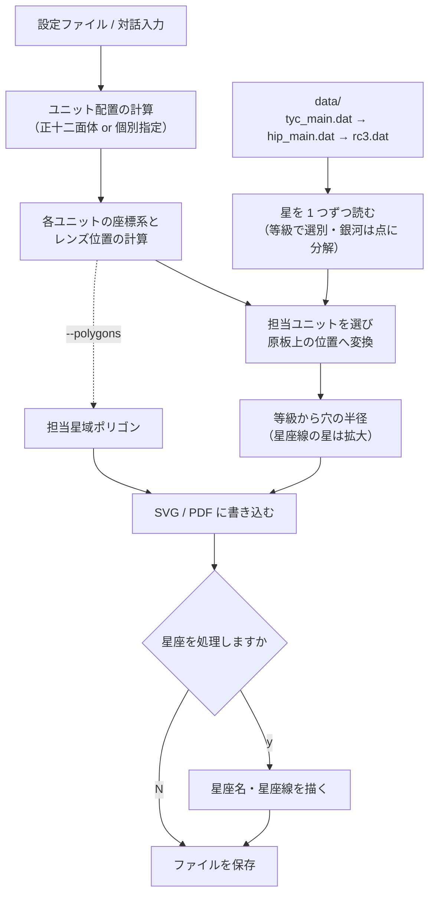

# 全体の構成

OTL の全体像をまとめます。インストールと基本の使い方は [README](../README.md)、
計算の詳細は [仕組み](mechanism.md)、設定の一覧は [設定の一覧](configuration.md) を参照してください。

## 処理の流れ



| 段階 | 内容 | 主な処理 |
|---|---|---|
| 設定 | 設定ファイル（または対話入力）から寸法・ユニット配置・等級などを読む | `transformer._init_transformer` ほか |
| 配置 | ユニットの向きを決め、各ユニットの原板の座標軸とレンズの位置を計算する | `StandardUnitArrangement`、`Transformer.__init__` |
| 読み込み | 星表を 1 行ずつ読み、等級で選別する。銀河は点の集まりに分解する | `SphereReader.read_star` |
| 変換 | 星を担当するユニットを選び、原板上の位置 (mm) に変換する | `Transformer.transform` / `transform_unit` |
| 穴の大きさ | 等級から穴の半径を決め、星座線の星を拡大する | `BasicTransformer.transform_star` / `enlarge_constellation_star` |
| 担当星域 | 各原板の担当範囲の境界を求める（`--polygons` のとき） | `PlateAssignmentPolygonGenerator` |
| 書き出し | A4 用紙に原板を並べ、SVG・PDF に書く | `PlateWriterSVG` / `PlateWriterPDF` |

PDF は同じフォルダに一時ファイルを書いてから置き換えます。保存に失敗しても、前回の PDF はそのまま残ります。

## フォルダとモジュール

| フォルダ | 内容 |
|---|---|
| `otl/` | Python パッケージ本体（`python3 -m otl` で実行） |
| `data/` | 星表・星座カタログ（`tyc_main.dat` は Git LFS） |
| `config/` | 設定ファイル `starconfig.properties` と、拡大する星座リストの例 `constellations.txt` |
| `output/` | 生成物。`default/` は設定を省略したときの出力先、`inverse/` は同梱の設定ファイルの出力先 |
| `tests/` | テスト |
| `docs/` | このドキュメントと画像 |

| モジュール | 役割 |
|---|---|
| `__main__.py` | `python3 -m otl` の入口 |
| `transformer.py` | コマンドライン引数・設定の読み込みと、天球から原板への座標変換（`Transformer`） |
| `basic_transformer.py` | 変換の共通処理。等級から穴の半径、星座線の星の拡大、星と星座の処理ループ |
| `unit_arrangement.py` | ユニット配置。正十二面体に基づく配置（`StandardUnitArrangement`）と個別指定（`CustomUnitArrangement`） |
| `geometry.py` | 正十二面体と錐体の幾何。ユニット配置に必要な画角の計算に使う |
| `mathvector.py` | 3 次元ベクトル |
| `models.py` | 天球・原板上の位置、星、星座のデータクラス |
| `sphere_reader.py` | 星表（Tycho・Hipparcos・RC3）と星座データ（IAU88.hlc）の読み込み |
| `galaxy_profile.py` | RC3 の銀河の明るさの広がり（指数円盤の尺度）を求める |
| `plate_polygon.py` | 各原板の担当星域の境界を求める |
| `plate_writer.py` | 原板を A4 用紙に配置して SVG・PDF に書き出す |
| `config.py` | Java 形式の `.properties` ファイルの読み込み |

## 用語

| 用語 | 意味 |
|---|---|
| ユニット | 投影機の 1 つのレンズと原板の組。1 つのユニットが空の一部を担当する |
| 北天 / 南天 | 投影機の 2 つの球。北天用（N）はドームの中心から天の北極の方向へ、南天用（S）は天の南極の方向へ `projector-distance` だけずれた位置にある |
| 原板（原盤） | ユニットに入れる 1 枚の版。星の位置に穴をあける。ファイル内では `N0`・`S3` のように半球と番号で呼ぶ |
| 担当星域 | そのユニットが投影する空の範囲。各星はちょうど 1 つの原板に描かれる |
| 最輝星 / 最微星 | 原板に描く最も明るい / 暗い星の等級（`star.maximum` / `star.minimum`） |
| 星座線の構成星 | `IAU88.hlc` で星座線を結ぶ星。拡大の対象になる |

## 用紙への配置

用紙は A4（210 × 297 mm）です。上半分（148.5 mm）に北天、下半分に南天の原板を置きます。

- 1 ページに `plate.column × plate.row` 組の原板が入ります。同梱の設定は 1 × 1 なので、北天・南天 16 枚ずつで 16 ページ（`star-0` 〜 `star-15`）です。
- 原板の番号は上の行から下へ、次に右の列へと進みます。
- 原板名（`N0` など）は枠の上に、向きの目印の × 印は枠の左上の外に描きます。
- `plate.frame-radius` を `0` にすると、枠の半径を `(min(210 / 列数, 148.5 / 行数) − 10) / 2` mm で自動計算します。
- 円形の枠の外に中心がある星の穴は描きません。

| 設定 | 原板 | 星 |
|---|---|---|
| `color.invert = no` | 白（枠線のみ） | 黒 |
| `color.invert = yes` | 黒で塗りつぶし | 白 |

担当星域（`polygon_*`）は、`color.invert` にかかわらず黒い原板に白い領域で描きます。

## 出力先

`output.directory`（省略時は `output/default`）の中に、種類ごとのフォルダを作ります。

| サブフォルダ | ファイル名 | 内容 |
|---|---|---|
| `star_SVG/` / `star_pdf/` | `<file.prefix><ページ番号>.svg` / `.pdf` | 恒星原板 |
| `polygon_SVG/` / `polygon_pdf/` | `<polygon.file-prefix><ページ番号>.svg` / `.pdf` | 担当星域 |
| `unit_position/` | `unit-position-file` の値 | ユニットの向きを北天・南天ごとに示した配置図 |

`output.directory` の相対パスは、実行したフォルダが基準です。星表と同梱の設定ファイルは、実行したフォルダにかかわらず `otl/` の 1 つ上のフォルダから探します。

## テスト

```bash
python3 -m unittest discover tests
```

| ファイル | 主な内容 |
|---|---|
| `tests/test_features.py` | 星座線の構成星の拡大、RC3 の読み込みと等級、暗い星・銀河の設定、担当星域ポリゴン、原板の枠、PDF の保存 |
| `tests/test_galaxy_profile.py` | 銀河の明るさの広がりの計算 |
